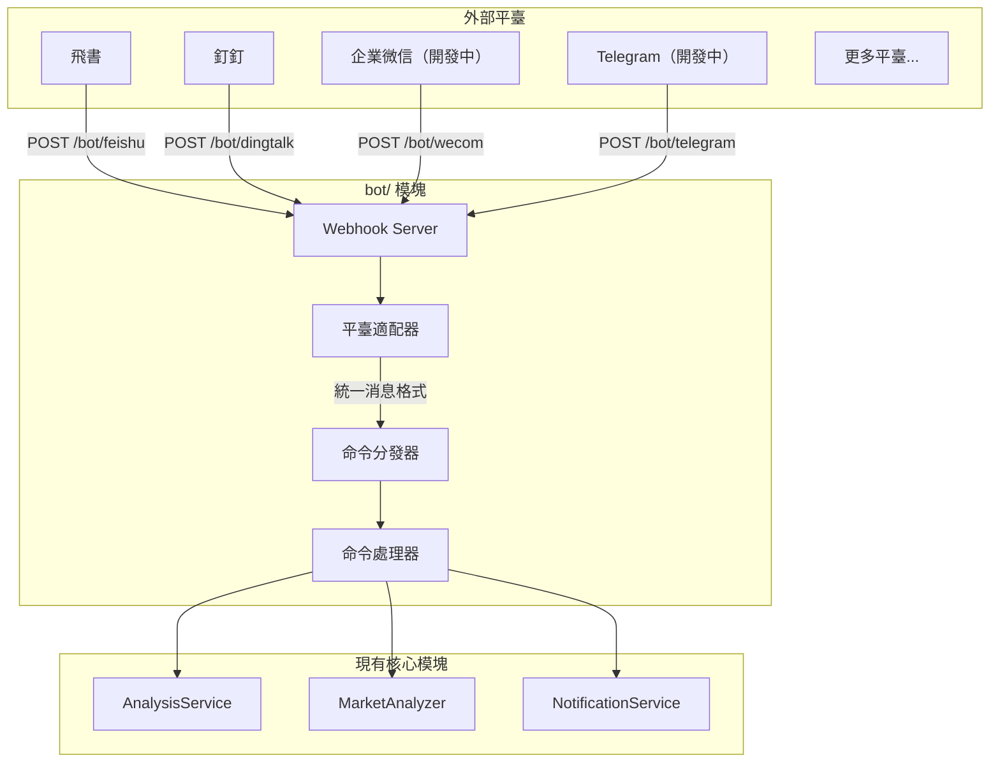

## 一、整體設計




## 二、目錄結構

在項目根目錄新建 `bot/` 目錄：

```
bot/
├── __init__.py             # 模塊入口，導出主要類
├── models.py               # 統一的消息/響應模型
├── dispatcher.py           # 命令分發器（核心）
├── commands/               # 命令處理器
│   ├── __init__.py
│   ├── base.py             # 命令抽象基類
│   ├── analyze.py          # /analyze 股票/指數分析
│   ├── market.py           # /market 大盤覆盤
│   ├── help.py             # /help 幫助信息
│   └── status.py           # /status 系統狀態
└── platforms/              # 平臺適配器
    ├── __init__.py
    ├── base.py             # 平臺抽象基類
    ├── feishu.py           # 飛書機器人
    ├── dingtalk.py         # 釘釘機器人
    ├── dingtalk_stream.py  # 釘釘機器人Stream
    ├── wecom.py            # 企業微信機器人 （開發中）
    └── telegram.py         # Telegram 機器人 （開發中）
```

## 三、核心抽象設計

### 3.1 統一消息模型 (`bot/models.py`)

```python
@dataclass
class BotMessage:
    """統一的機器人消息模型"""
    platform: str           # 平臺標識: feishu/dingtalk/wecom/telegram
    user_id: str            # 發送者 ID
    user_name: str          # 發送者名稱
    chat_id: str            # 會話 ID（群聊或私聊）
    chat_type: str          # 會話類型: group/private
    content: str            # 消息文本內容
    raw_data: Dict          # 原始請求數據（平臺特定）
    timestamp: datetime     # 消息時間
    mentioned: bool = False # 是否@了機器人

@dataclass
class BotResponse:
    """統一的機器人響應模型"""
    text: str               # 回覆文本
    markdown: bool = False  # 是否為 Markdown
    at_user: bool = True    # 是否@發送者
```

### 3.2 平臺適配器基類 (`bot/platforms/base.py`)

```python
class BotPlatform(ABC):
    """平臺適配器抽象基類"""
    
    @property
    @abstractmethod
    def platform_name(self) -> str:
        """平臺標識名稱"""
        pass
    
    @abstractmethod
    def verify_request(self, headers: Dict, body: bytes) -> bool:
        """驗證請求籤名（安全校驗）"""
        pass
    
    @abstractmethod
    def parse_message(self, data: Dict) -> Optional[BotMessage]:
        """解析平臺消息為統一格式"""
        pass
    
    @abstractmethod
    def format_response(self, response: BotResponse) -> Dict:
        """將統一響應轉換為平臺格式"""
        pass
```

### 3.3 命令基類 (`bot/commands/base.py`)

```python
class BotCommand(ABC):
    """命令處理器抽象基類"""
    
    @property
    @abstractmethod
    def name(self) -> str:
        """命令名稱 (如 'analyze')"""
        pass
    
    @property
    @abstractmethod
    def aliases(self) -> List[str]:
        """命令別名 (如 ['a', '分析'])"""
        pass
    
    @property
    @abstractmethod
    def description(self) -> str:
        """命令描述"""
        pass
    
    @property
    @abstractmethod
    def usage(self) -> str:
        """使用說明"""
        pass
    
    @abstractmethod
    async def execute(self, message: BotMessage, args: List[str]) -> BotResponse:
        """執行命令"""
        pass
```

### 3.4 命令分發器 (`bot/dispatcher.py`)

```python
class CommandDispatcher:
    """命令分發器 - 單例模式"""
    
    def __init__(self):
        self._commands: Dict[str, BotCommand] = {}
        self._aliases: Dict[str, str] = {}
    
    def register(self, command: BotCommand) -> None:
        """註冊命令"""
        self._commands[command.name] = command
        for alias in command.aliases:
            self._aliases[alias] = command.name
    
    def dispatch(self, message: BotMessage) -> BotResponse:
        """分發消息到對應命令"""
        # 1. 解析命令和參數
        # 2. 查找命令處理器
        # 3. 執行並返回響應
```

## 四、已支持的命令

| 命令 | 別名 | 說明 | 示例 |

|------|------|------|------|

| /analyze | /a, 分析 | 分析指定股票或已登記指數 | `/analyze 600519`、`/analyze sh000016`、`/analyze 上證50` |

| /market | /m, 大盤 | 大盤覆盤 | `/market` |

| /batch | /b, 批量 | 批量分析自選股 | `/batch` |

| /help | /h, 幫助 | 顯示幫助信息 | `/help` |

| /status | /s, 狀態 | 系統狀態 | `/status` |

### `/analyze` 支持邊界

- 股票：A 股 6 位數字（`600519`）、港股 `HK+5 位數字`（`hk00700`）、美股 1-5 個字母（`AAPL`、`usfd`→`USFD`）。股票名稱（`贵州茅台`）由本次 Bot 入口新暴露：複用既有名稱解析器（`resolve_name_to_code`）解析後提交 legacy code，不攜帶結構化 target。
- 已登記指數：顯式代碼（`sh000016`）、CSI alias（`930955.CSI` 收斂為 `csi930955`）、註冊中文名（`上证50`）均可提交；指數以結構化 `AnalysisTarget` 貫穿到分析 Pipeline，`sh000016` 不會被改寫為 `SH000016`。
- 未登記 CSI（如 `930956.CSI`）、舊閘門拒絕的代碼形態（如 `12345`、裸 `00700`、`600519.SH`、未登記 `sh999999`）或無法識別的名稱：返回明確錯誤，不提交任務。
- 註冊表內存在等價名稱歧義時：要求改用顯式代碼，不猜測、不進入股票名稱兜底。

### Bot 指數入口在線 E2E smoke（`scripts/smoke_bot_index_entry.py`）

用於從真實 `CommandDispatcher.dispatch_async -> AnalyzeCommand -> TaskService -> StockAnalysisPipeline` 在線貫穿單標的分析，覆蓋 `SH.000016` / `上证50` / `930955.CSI` 三條矩陣場景，不經過任何 webhook transport（不 mock 在線依賴、不 dry-run）。

運行（單 target 參數，`--timeout` 默認 900 秒）：

```powershell
.venv\Scripts\python.exe scripts/smoke_bot_index_entry.py "SH.000016"
.venv\Scripts\python.exe scripts/smoke_bot_index_entry.py "上证50"
.venv\Scripts\python.exe scripts/smoke_bot_index_entry.py "930955.CSI"
```

進程職責：worker 獨立子進程提交併輪詢（同進程 `TaskService`），輸出單行 `E2E_EVENT {json}` 事件（`phase=submitted|completed|failed|timeout`，含 `target`，按階段附加 `task_id`/`stock_code`/`result`/`error`）；父進程只負責 deadline、進程樹清理和退出碼（0=成功 / 1=失敗 / 124=超時）。

失敗語義：任務失敗、completed 但結果不完整（canonical code 或註冊名稱與矩陣期望不符，或 `analysis_summary`/`operation_advice`/`trend_prediction` 任一為空或僅空白）即輸出 `failed` 事件並不為零退出；超時清理進程樹（Windows `taskkill /T /F`，POSIX 殺進程組），清理成功輸出 `timeout` 事件並退出 124，清理失敗則輸出含清理錯誤的 `failed` 事件並退出 1，不回滾 DB / 報告 / 通知等既有副作用。用戶 Ctrl-C 中止時父進程同樣先清理進程樹：清理成功透傳中斷，清理失敗輸出含清理錯誤的 `failed` 事件並退出 1，絕不靜默吞掉清理失敗。worker 的期望 code/name 來自腳本內置的矩陣權威映射（`SH.000016`/`上证50` → `sh000016`/`上证50`，`930955.CSI` → `csi930955`/`红利低波100`），不信任響應或任務結果自報身份：提交響應的 `stock_code` 與期望不符時輸出含期望值與實際值的顯式 mismatch 錯誤（failed 事件同時攜帶結構化 `stock_code` 實際值）；矩陣之外的 target 與非正 `--timeout` 在提交與子進程 spawn 之前即被拒絕（參數/輸入錯誤，退出碼 2）。worker 意外異常（dispatch/輪詢/事件序列化）輸出 `failed` 事件並退出 1（異常證據保留在 stderr），`KeyboardInterrupt` 不按普通失敗處理；父進程將 worker 的任意其他退出碼歸一化為 1，運行時契約只暴露 0 / 1 / 124。父進程以內部 `--worker` flag 顯式拉起子進程，不依賴環境變量。

前置條件：需要網絡與數據源/AI 憑據配置齊全（在線鏈路）。本腳本不屬於離線 gate，不進入 CI。

## 五、`/status` 與模型配置診斷說明

### 可配置層級與可用性判斷依據

- `/status` 顯示的 LLM 可用性遵循系統統一運行時優先級：
  - `LITELLM_CONFIG`（LiteLLM YAML）
  - `LLM_CHANNELS`
  - legacy provider 鍵（`GEMINI_API_KEY` / `OPENAI_API_KEY` / `ANTHROPIC_API_KEY` / `DEEPSEEK_API_KEY`）
- 當主模型（`LITELLM_MODEL` 或 `AGENT_LITELLM_MODEL`）在當前激活層無可用來源時，會展示“AI 服務未配置”，並保留用戶可見原因行。
- 本倉庫 `requirements.txt` 的運行時依賴約束為 `litellm>=1.80.10,!=1.82.7,!=1.82.8,<1.99.0`，該約束內本鏈路以現有兼容行為為準。
- 該診斷規則與 `GET /api/v1/system/config/setup/status` 的 LLM 檢查保持一致：`LITELLM_CONFIG`/`LLM_CHANNELS` 為高優先級；模式切換時不會做靜默遷移，切回舊模式由用戶顯式恢復歷史值或回滾。

### 回退與遷移邊界

- `LITELLM_CONFIG` 與 `LLM_CHANNELS` 任一生效時，下層 legacy 配置會被該層忽略（不會繼續作為本次調用來源）。
- 診斷增強不進行 silent migration：不會主動清空/刪除 `GEMINI_*`、`OPENAI_*`、`ANTHROPIC_*`、`LITELLM_*` 的歷史值，僅在可用性診斷上提示。

### 官方兼容來源（用於排障核對）

- LiteLLM 官網：<https://docs.litellm.ai/>
- LiteLLM OpenAI Compatible 說明：<https://docs.litellm.ai/docs/providers/openai_compatible>
- OpenAI Chat API：<https://platform.openai.com/docs/api-reference/chat>
- DeepSeek API 文檔：<https://api-docs.deepseek.com/>
- Kimi Moonshot 兼容說明：<https://platform.moonshot.ai/docs/guide/compatibility>
- Gemini OpenAI 兼容說明：<https://ai.google.dev/gemini-api/docs/openai>
- Ollama API 文檔：<https://github.com/ollama/ollama/blob/main/docs/api.md>

## 六、Webhook 路由

在 [api/v1/router.py](../api/v1/router.py) 中註冊路由：

```python
# Webhook 路由
/bot/feishu      # POST - 飛書事件回調
/bot/dingtalk    # POST - 釘釘事件回調
/bot/wecom       # POST - 企業微信事件回調 （開發中）
/bot/telegram    # POST - Telegram 更新回調 （開發中）
```

## 配置

在 [config.py](../src/config.py) 中新增機器人配置：

```python
# === 機器人配置 ===
bot_enabled: bool = False              # 是否啟用機器人
bot_command_prefix: str = "/"          # 命令前綴

# 飛書機器人（事件訂閱）
feishu_app_id: str                     # 已有
feishu_app_secret: str                 # 已有
feishu_verification_token: str         # 新增：事件校驗 Token
feishu_encrypt_key: str                # 新增：加密密鑰

# 釘釘機器人（應用）
dingtalk_app_key: str                  # 新增
dingtalk_app_secret: str               # 新增

# 企業微信機器人（開發中）
wecom_token: str                       # 新增：回調 Token
wecom_encoding_aes_key: str            # 新增：EncodingAESKey

# Telegram 機器人（開發中）
telegram_bot_token: str                # 已有
telegram_webhook_secret: str           # 新增：Webhook 密鑰
```

## 擴展說明
### 怎樣新增一個通知平臺

1. 在 `bot/platforms/` 創建新文件
2. 繼承 `BotPlatform` 基類
3. 實現 `verify_request`, `parse_message`, `format_response`
4. 在路由中註冊 Webhook 端點

### 怎樣新增新增命令

1. 在 `bot/commands/` 創建新文件
2. 繼承 `BotCommand` 基類
3. 實現 `execute` 方法
4. 在分發器中註冊命令

## 安全相關配置

- 支持命令頻率限制（防刷）
- 敏感操作（如批量分析）可設置權限白名單

在 [config.py](../src/config.py) 中新增機器人安全配置：

```python
    bot_rate_limit_requests: int = 10     # 頻率限制：窗口內最大請求數
    bot_rate_limit_window: int = 60       # 頻率限制：窗口時間（秒）
    bot_admin_users: List[str] = field(default_factory=list)  # 管理員用戶 ID 列表，限制敏感操作
```
