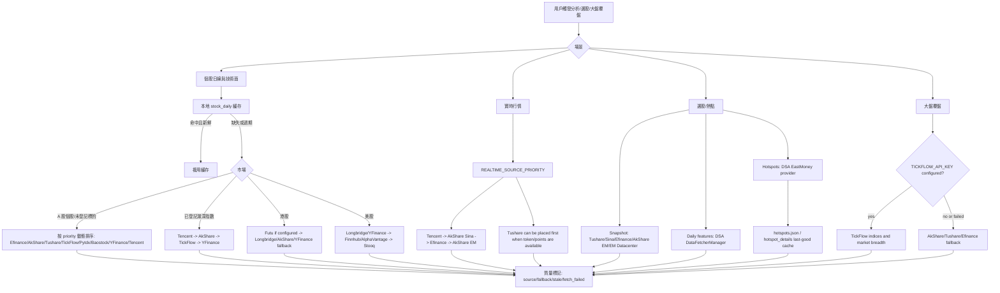
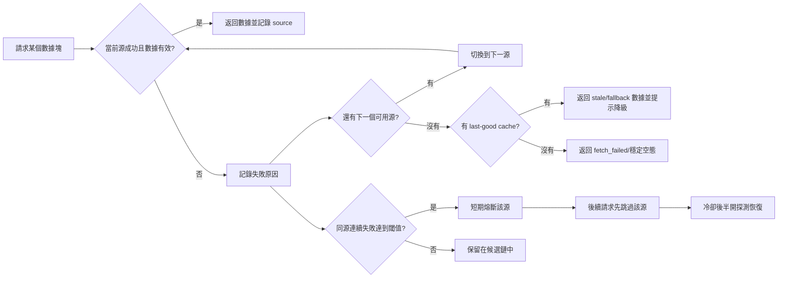
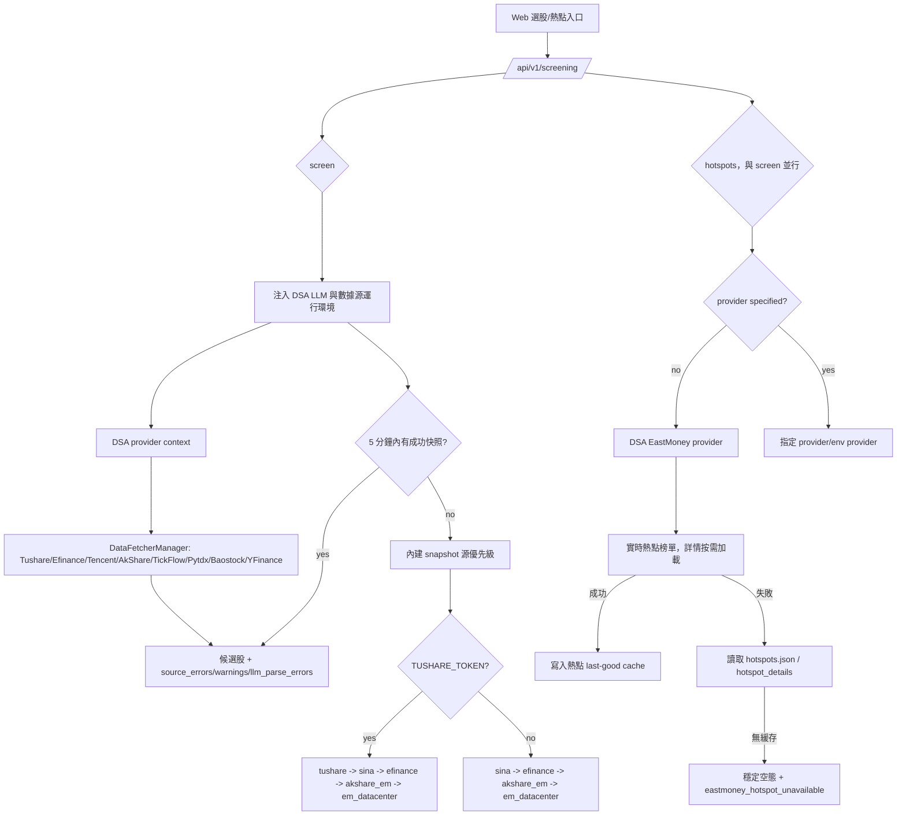

# 數據源穩定性與故障處理圖示

本文面向用戶、部署者和維護者，說明 DSA 已接入的數據源如何參與分析、選股和大盤覆盤，以及當數據源失敗時系統會怎麼降級。

核心原則：先用項目已經接入並驗證過的數據源，把失敗路徑講清楚；新增外部數據源應放在第二階段，避免先擴大維護面。

## 基本面報告期與股票範圍

AkShare 的業績預告、快報是按 `date=YYYYMMDD` 查詢的全市場表，機構持股按“年份+季度”查詢；適配器依次嘗試最近兩個已結束季度，並在返回前篩選當前股票。表中沒有目標股票或缺少代碼列時繼續嘗試前一期，不會用其他股票的首行，也不會退回接口內置的多年以前默認日期。十大股東查詢複用現有滬/深/北代碼轉換，明確傳入帶市場前綴的股票和報告期。

機構推薦不代表機構持倉變化，普通股東戶數也不代表十大股東持倉變化；這些不同含義的數據不會再作為對應字段的備用來源。業績報表也不再替代業績預告。未披露、缺數據或上游解析失敗時保留局部數據和錯誤診斷；`partial` 本身不代表全部取數失敗。此修復不改變超時預算、普通日 K 數據源優先級、API/報告字段或用戶配置，也不保證上游東財返回結構始終可用。

業績快報摘要只從實際返回的營收、淨利潤、同比、每股收益和淨資產收益率生成，保留零值與負值；公告日期不作為快報內容。業績預告按明確的披露文本字段提取，不把日期或變動幅度數值當作摘要。只有日期或指標全部缺失時不生成有效摘要，避免緩存及 Agent 輸出把元數據誤當作業績信息。

## 一句話答覆用戶

如果遇到“數據源失敗”，通常不是系統只能用一個源，而是免費源被限流、上游接口臨時變更、網絡抖動或當前市場/標的不支持。DSA 已經內置多數據源 fallback，會按場景自動嘗試下一個源；如果你希望更穩定，建議至少配置一個 token 型穩定源：

- A 股個股與選股：優先配置 `TUSHARE_TOKEN`，並保留 AkShare / Efinance / Tencent / TickFlow / Baostock / YFinance 兜底；普通個股日線按 priority 配置排序。
- 已登記 A 股指數：固定按 Tencent → AkShare → TickFlow → YFinance 降級，不讀取普通日 K 的 `*_PRIORITY` 配置。
- A 股大盤覆盤：配置 `TICKFLOW_API_KEY` 後，覆盤聚合所需的指數和市場寬度會優先嘗試 TickFlow，失敗後回退現有免費源；這與單標的指數日線的 Tencent-first 固定鏈是不同入口。
- 港股：配置 `FUTU_OPEND_HOST` 後，Futu 可作為港股實時與基本面主源；`FUTU_HK_REALTIME_SOURCE_PRIORITY` 控制港股實時行情順序，Longbridge、AkShare、YFinance 保留為 fallback；OpenD 未運行或 5 秒內未完成協議就緒時本次請求直接回退，並在 5 分鐘內跳過 Futu，避免整輪分析阻塞。
- 美股：配置 `LONGBRIDGE_*` 後可優先使用 Longbridge，YFinance 保留實時主鏈 fallback；Finnhub、AlphaVantage 只在已有主源報價後補充字段或參與日線鏈，不能在 Longbridge/YFinance 全部失敗時獨立返回實時報價。
- 熱點題材：選股的熱點實現參考 AlphaSift，默認走 EastMoney provider，並使用本地 last-good cache 降低實時接口失敗影響。

## 已接入數據源矩陣

| 場景 | 已接入源 | 默認使用方式 | 失敗處理 |
| --- | --- | --- | --- |
| A 股個股日線 / 技術面 | Efinance、Tencent、AkShare、Tushare、TickFlow、Pytdx、Baostock、YFinance | `DataFetcherManager` 按 priority 嘗試；配置 `TUSHARE_TOKEN` 後 Tushare 自動進入候選源 | 單源失敗後嘗試下一個源；連續失敗會短期熔斷該源 |
| 已登記 A 股指數日線 / 技術面 | Tencent、AkShare、TickFlow、YFinance | 當前 5 個 `IndexRegistry` 標的固定按 Tencent → AkShare → TickFlow → YFinance 嘗試，不讀取普通日 K 的 `*_PRIORITY` 配置 | 未配置、熔斷、異常或空結果均繼續下一源；全部失敗返回空結果並記錄彙總告警 |
| A 股實時行情 | Tencent、AkShare Sina、Efinance、AkShare EM、Tushare | `REALTIME_SOURCE_PRIORITY` 控制順序，默認偏向 Tencent / Sina 這類輕量源 | 失敗源記錄 `fallback_from`，成功源繼續返回 |
| A 股大盤覆盤 | TickFlow、AkShare、Tushare、Efinance | 配置 `TICKFLOW_API_KEY` 後，覆盤聚合的主指數和市場寬度優先嘗試 TickFlow；不等同於單標的指數日線鏈 | TickFlow 權限不足或失敗時回退 AkShare / Tushare / Efinance 鏈路 |
| 選股快照 | Tushare、Sina、Efinance、AkShare EM、EastMoney Datacenter | 有 `TUSHARE_TOKEN` 時自動把 `tushare` 放入快照優先級；否則使用免費源鏈路 | 選股引擎維護 source health；狀態接口透出 snapshot/daily health |
| 選股日線補特徵 | `DataFetcherManager` | 選股引擎優先複用現有日線與緩存鏈路 | 現有鏈路失敗後才回到引擎自身的日線源 |
| 選股熱點題材 | EastMoney provider、參考 AlphaSift 的 hotspot 實現、last-good cache | 未指定 provider 時默認使用 EastMoney provider | 實時失敗時回退熱點緩存；無緩存時返回穩定空態和可讀錯誤 |
| 港股 | Futu、Longbridge、YFinance、AkShare、Tushare | 配置 `FUTU_OPEND_HOST` 後 Futu 作為實時與基本面主源，按 `FUTU_HK_REALTIME_SOURCE_PRIORITY` 順序嘗試 | Futu 失敗時回退 Longbridge / AkShare / YFinance；Longbridge 冷卻或失敗時繼續回退 YFinance / 其他可用源 |
| 美股 | Longbridge、YFinance、AkShare、Tushare、Finnhub、AlphaVantage、Stooq | 配置 Longbridge 憑證後參與美股日線/實時主鏈；YFinance 保持實時基礎 fallback；Finnhub/AlphaVantage 可補充已有報價字段並參與日線鏈 | Longbridge 冷卻或失敗時實時主鏈回退 YFinance；兩者都失敗時不把補充源偽裝成可獨立返回報價的 fallback |

## 統一數據能力只讀契約

Web/API 提供 `GET /api/v1/data/overview` 和等價別名 `GET /api/v1/data/capabilities`，用於把數據源能力、數據集質量和場景優先級以同一個只讀結構暴露給首頁看板、數據中心、個股詳情、自選和選股頁面。

首版契約只讀取配置和 `DataFetcherManager` 的 fetcher 快照，不觸發外部行情請求，也不返回任何原始密鑰。響應分三層：

- `providers`：每個 provider 的 `enabled`、`configured`、`status`、`markets`、`datasets`、精確的 `dataset_markets` 和非敏感 warning。`markets` 與 `datasets` 只是聚合索引，不能推斷為笛卡爾積；例如 YFinance 可參與 A 股行情，但 A 股基本面固定走 AkShare，因此 `dataset_markets.financial.snapshot` 不包含 `cn`。Finnhub/AlphaVantage 的美股報價 handler 當前只在 Longbridge/YFinance 已返回主報價後補字段，因此不聲明 `quote.realtime` 獨立路由能力。
- `datasets`：`quote.realtime`、`kline.daily`、`index.daily`、`market.overview`、`financial.snapshot`、`news.events`、`strategy.screening`、`alert.monitor`、`portfolio.account` 的 `status/source/fallback_from/stale/warnings`；其中 `quote.realtime`、`kline.daily`、`market.overview` 和 `financial.snapshot` 都聚合市場級 coverage，避免把單市場健康度誤報成全局可用。A 股實時額外拆分 `cn` 股票優先級、`cn.index.exchange` 固定指數鏈和 `cn.index.csi` Efinance-only 鏈；美股實時拆分 `us` 個股動態優先級與 `us.index` 固定 YFinance-only 鏈。AkShare Tencent/Sina/EM、AkShare HK 雙子源、Efinance 股票/指數子源級熔斷及日線 breaker 會先於 provider-wide unknown 判定，使 overview 與運行時跳過行為一致。YFinance 的港股實時聲明對應其實際 `.HK` 執行路徑；未配置 OpenD 時 HK priority 與運行時一致地跳過 Futu；美股個股實時也按當前請求可用性跳過處於連接冷卻的 Longbridge，使 YFinance 成為實際主源而不是偽 fallback。PyTDX 不聲明未接入統一 route 的實時能力，YFinance 指數日線只聲明實際可執行的 CN/US route。任何按運行時順序嘗試的數據集在首個優先源尚未探測且沒有更具體的 open breaker 證據時保持 `unknown`，不會越過它宣稱後續源已被選中。`alert.monitor` 只有在開關啟用且當前 API 進程的 scheduler 已實際註冊並運行 `agent_event_monitor` 時才為 `ok`；開關關閉返回 `agent_event_monitor_disabled`，scheduler 未運行則返回 `agent_event_monitor_not_running`。
- `priorities`：`cn.realtime`、`hk.realtime`、`us.realtime`、`daily.generic`、`cn.index.daily`、`market.overview`、`screening.snapshot`、`news.events` 的當前 source order；`daily.generic` 與運行時一樣先排除當前請求不可用或處於連接冷卻的 fetcher，不把已跳過的數據源記錄成 fallback。
- `index.daily` 額外區分 `cn.exchange`、`cn.csi` 與 `us` coverage：滬深交易所指數使用 Tencent、AkShare、TickFlow、YFinance 固定多源鏈，CSI 指數按運行時契約只認 AkShare，美股指數只聲明當前能夠接收指數 symbol 的 YFinance；Finnhub 當前 fetcher 會拒絕指數 symbol，因此不作為偽 fallback。Tushare 不聲明指數日線能力。CN/HK realtime 都只接受對應運行時實際有 handler 的 source token，Tushare realtime 能力僅聲明 A 股。

其中 `unknown` 表示尚未執行運行態探測，`unconfigured` 表示缺少必要配置，`degraded` 表示前置優先源不可用但後續源仍可消費。選股 source health 在冷啟動、成功數和失敗數都為 0 時保持 `unknown`，不會把尚未調用的數據源提前標成 `ok`。後續 Data Center 可以在同一結構上追加 last_success、coverage、cooldown 和運行歷史，不需要各頁面各自維護數據質量口徑。

## 總體鏈路圖



## 失敗與降級圖



當前日線源熔斷策略為連續失敗 3 次後短期冷卻約 5 分鐘。它的目的不是永久禁用數據源，而是避免一個短時間不可用的源拖慢整批分析。

## 選股與熱點鏈路



## 推薦配置檔

### 免費模式

適合個人試用，依賴免費源自動 fallback。優點是不需要 token；缺點是更容易遇到上游限流或臨時接口變化。

```env
REALTIME_SOURCE_PRIORITY=tencent,akshare_sina,efinance,akshare_em
ENABLE_EASTMONEY_PATCH=true
```

### A 股穩定模式

適合經常跑選股、批量分析或對外服務。Tushare 用於增強普通 A 股日線與快照穩定性；TickFlow 可增強普通 A 股日 K、已登記指數固定 fallback、實時行情和大盤覆盤（實時行情需顯式加入 `REALTIME_SOURCE_PRIORITY`）；免費源繼續作為兜底。

```env
TUSHARE_TOKEN=your_tushare_token
TICKFLOW_API_KEY=your_tickflow_key

REALTIME_SOURCE_PRIORITY=tickflow,tushare,tencent,akshare_sina,efinance,akshare_em
SNAPSHOT_SOURCE_PRIORITY=tushare,sina,efinance,akshare_em,em_datacenter

# 選股運行期默認值；顯式配置時會保留你的值
DAILY_FETCH_RETRIES=3
DAILY_FETCH_MAX_WORKERS=1
```

注意：TickFlow 能力按套餐權限分層；權限不足或請求失敗時會 fail-open 回退到現有免費源，不建議把它當成所有市場行情的唯一來源。

### 港股 / 美股穩定模式

適合港美股組合、持倉和個股分析。Longbridge 配置後優先參與港美股鏈路；YFinance、Finnhub、AlphaVantage 作為兜底。

```env
LONGBRIDGE_OAUTH_CLIENT_ID=your_client_id
LONGBRIDGE_OAUTH_TOKEN_CACHE_B64=your_token_cache_base64

FINNHUB_API_KEY=your_finnhub_key
ALPHAVANTAGE_API_KEY=your_alphavantage_key
```

如果仍使用 Legacy Longbridge 憑證，也可以繼續配置：

```env
LONGBRIDGE_APP_KEY=your_app_key
LONGBRIDGE_APP_SECRET=your_app_secret
LONGBRIDGE_ACCESS_TOKEN=your_access_token
```

## 用戶可見提示建議

對外溝通時建議區分三類情況：

| 情況 | 建議提示 |
| --- | --- |
| 單個源失敗但 fallback 成功 | 本次使用了降級數據源，分析仍可繼續；報告中會標記實際成功源。 |
| 多個源失敗但有緩存 | 實時源不可用，本次使用上一次成功緩存；結論會降低置信度。 |
| 全部源失敗且無緩存 | 當前數據不可用，請稍後重試。普通 A 股可檢查 Tushare/TickFlow；已登記指數應檢查 Tencent/AkShare 連通性或配置 TickFlow；港美股可檢查 Longbridge。 |

普通 A 股日線使用 `cn` 健康度命名空間，已登記指數固定鏈使用獨立的 `cn_index` 命名空間；任一鏈的連續失敗不會熔斷另一條鏈。指數源返回空結果時會繼續 fallback 並記錄診斷，四源全部失敗則返回空結果和空來源；普通股票保留既有最終異常語義。

### 新聞面證據缺失的報告標註（已實現）

報告會區分新聞檢索**未執行**和**執行後零命中**，分別渲染對應提示：

> ⚠️ 未配置搜索渠道，本次分析未納入新聞面證據。

> ⚠️ 本次未獲取到可用的新聞面數據，以下結論未納入新聞維度證據。

覆蓋 dashboard、brief、個股與日報四個渲染路徑，以及歷史 Markdown、分享圖片和 Web
報告詳情；中文、英文、韓文報告使用各自的披露文案。該提示的判定獨立於模型輸出：
即使 LLM 按 schema 寫出了 `market_sentiment` / `hot_topics`，只要檢索零命中就照常提示，
避免出現「展示模型生成的情緒判斷、卻隱瞞無新聞證據」這一組合。

判定依據是 `AnalysisResult.news_result_count`：

| 取值 | 含義 | 是否提示 |
| --- | --- | --- |
| `None` | 未執行檢索（未配置搜索渠道） | **是**——明確說明本次分析沒有新聞面證據 |
| `0` | 執行了檢索但零命中（搜索源限流、全部失敗等） | **是** |
| `> 0` | 正常拿到新聞 | 否 |

新記錄會把該三態值隨分析結果持久化，保證實時報告和歷史報告一致。舊記錄若沒有保存
`news_result_count`，其新聞檢索狀態只能視為未知，歷史展示保持原樣，不會倒推為“未配置搜索渠道”。

## 資金流數據邊界

個股資金流通過 AkShare `stock_individual_fund_flow` 顯式傳入股票代碼和滬深北市場，按有效日期選擇最新交易日，讀取 `主力净流入-净额`（元）。不把淨佔比、排名、默認股票或其他股票的數據當成目標股票的資金流。當前日線接口不提供 5 日 / 10 日累計金額，這兩個字段保持缺失。

行業排名只讀取 `stock_sector_fund_flow_rank` 的 `今日主力净流入-净额`，不降級到某個行業的個股明細表。行業金額中的缺失值及正負無窮值被過濾，零值和負值保留；全部金額無效時返回空排名，仍保留已取得的個股金額及來源鏈。個股源失敗時仍可返回行業排名；沒有有效日期或有限金額時不標記個股資金流成功。上述邊界遵循 [AkShare 官方接口契約](https://akshare.akfamily.xyz/data/stock/stock.html)。本節為中文專題說明，沒有對應英文文檔。

## 後續可做的產品化增強

1. 數據源 Doctor 頁面：展示每個源最近成功時間、失敗原因、熔斷狀態和下一次恢復探測時間。
2. 一鍵推薦配置：根據市場選擇生成 `.env` 片段，例如“A 股穩定模式”“港美股穩定模式”“免費模式”。
3. 選股狀態面板：直接展示 snapshot/daily source health，讓用戶知道是 Sina、Efinance、AkShare 還是 Tushare 出問題。
4. 批量任務限速策略：對免費源自動降低併發，優先複用本地日線緩存，減少觸發上游限流。
5. 可選商業源接入：只有在現有 Tushare / TickFlow / Longbridge / Finnhub / AlphaVantage 仍不能覆蓋需求時，再考慮新增 Twelve Data、Massive/Polygon、Nasdaq Data Link 等源。

## 財務摘要表結構

新浪當前還使用 `营业总收入增长率`、`归属母公司净利润增长率`、`净资产收益率(ROE)` 和 `经营现金流量净额`。這些標籤與已有規範字段作明確映射，不通過模糊匹配把金額和增長率混用；原有帶單位標籤繼續支持。

AkShare `stock_financial_abstract` 返回“指標行 + 報告期列”的寬表。適配層選取最新有效報告期列，以明確的指標名讀取收入、歸母淨利潤、經營現金流、同比增長率、ROE 和毛利率。同比百分比不能填入金額字段；缺失值保持缺失，不跨報告期補值。僅有報告日期或全部指標為空時，不標記財務數據成功。普通行表仍沿用現有解析路徑。

指標別名兼容上游帶單位的名稱，包括 `营业总收入(元)`、`归属净利润(元)`、`营业总收入同比增长(%)`、`归属净利润同比增长(%)`、`经营现金流量净额(元)`、`净资产收益率(加权)(%)` 和 `销售毛利率(%)`；仍按完整名稱精確匹配，避免混淆金額、百分比與不同口徑的指標。

接口形狀參考 [AkShare 官方文檔](https://akshare.akfamily.xyz/data/stock/stock.html)。本節為中文專題說明，沒有對應英文文檔。

## 基本面耗時診斷

基本面調用的 `duration_ms` 表示本次調用實際等待的毫秒數，使用單調時鐘計時，包括成功、異常、等待超時和線程池拒絕。它不表示配置的超時預算；線程池已滿時通常會快速返回。超時只停止當前等待，不證明後臺請求已退出，因此不能單憑耗時是否等於預算判斷請求“掛死”。本次診斷修復不改變線程槽位和取消語義。本說明沒有對應英文專題文檔。

## 基本面超時與後臺任務

基本面 fetch 超時只結束本輪等待，Python 線程中的第三方調用仍可能繼續運行。每個管理器的 8 個後臺槽位只在真實任務結束後釋放，不能把“返回 timeout”當作取消成功。

對於 AkShare 財務包、資金流、龍虎榜三個獨立操作，首次超時後，只要該操作仍有超時任務在後臺運行，當前進程內的後續請求（包括其他股票、重新創建的分析管理器）就會快速返回 `timeout: previous request still running`，不再重複啟動相同操作。真實任務成功或異常退出後自動解除保護；若同批併發中已有多個任務超時，需要全部退出。健康調用的併發不變，實時估值、板塊多源 fallback 及其他提供方的路徑不受此保護鍵影響。

這是重複請求抑制，不是後臺取消或全進程線程上限。保護生效前已經併發進入的請求不會被中止；未接入保護鍵的操作仍受原來的每管理器槽位限制。某操作永久掛起時，該操作在當前進程中持續降級，其他操作仍可繼續；徹底回收永久掛起的第三方調用仍需底層網絡 timeout 或單獨設計進程隔離，並驗證桌面凍結包和跨平臺兼容。保護不跨進程共享，不緩存遲到的結果，也不改變既有基本面緩存 TTL。沒有新增配置或 API 字段。本節為中文專題說明，沒有對應英文文檔。

## 官方資料

- Tushare: https://tushare.pro/document/2
- TickFlow: https://tickflow.org/
- AkShare: https://akshare.akfamily.xyz/
- Longbridge OpenAPI: https://open.longportapp.com/
- Finnhub API: https://finnhub.io/docs/api
- Alpha Vantage API: https://www.alphavantage.co/documentation/
